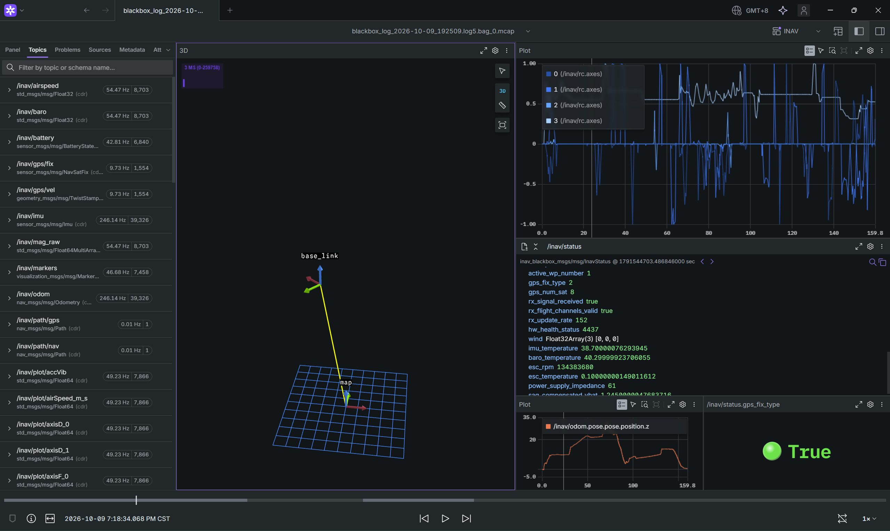

# inav_blackbox_ros2

Convert INAV(BetaFlight may also work) blackbox logs into a rosbag2 / MCAP bag, so you can debug flights with powerful visualization tools that work with ROS 2 messages: [Foxglove Studio](https://foxglove.dev/), rviz2, or [Rerun](https://rerun.io/).



Conversion only. There is no live publisher node, no bundled rviz2/Foxglove layout and no launch
file — replay is `ros2 bag play` and Foxglove's own file open.

## Build

Needs ROS 2 Jazzy, the rosbag2 MCAP storage plugin, `rcutils`, `ament_index_cpp`, `tf2_msgs`,
`visualization_msgs` and the usual message packages. `bin/blackbox_decode`
(iNavFlight/blackbox-tools v9.0.0) ships with the package and is installed to `share/bin`; the
converter looks for `--decoder`, then `$INAV_BLACKBOX_DECODE`, then that directory, then `$PATH`.

```bash
colcon build --packages-up-to inav_blackbox_ros2 --cmake-args -DCMAKE_BUILD_TYPE=Release
source install/setup.bash
```

> Never run `blackbox_decode` by hand without `--stdout` — it writes `.csv`/`.event`/`.gpx` next to
> the input. Every call through this package streams from a pipe.

## Use

```bash
ros2 run inav_blackbox_ros2 inav_blackbox_to_bag --list <log.TXT>     # logs inside the file
ros2 run inav_blackbox_ros2 inav_blackbox_to_bag -i 4 <log.TXT>       # convert the fourth one

ros2 bag play --clock 40 <bag>                          # timestamps are absolute UTC: give sim time
ros2 run rviz2 rviz2 --ros-args -p use_sim_time:=true   # Fixed Frame: map
```

INAV logs are binary even when they carry a `.TXT` extension. In Foxglove, open the `*.mcap` from
the bag directory: schemas are self-contained `ros2msg`, custom message included.

```
inav_blackbox_to_bag [options] <log.TXT|log.bbl>

  -o, --output <dir>   bag directory (default <log>.log<N>.bag)
  -i, --index <n>      which log inside the file (default 1)
      --all            one bag per log
  -l, --list           list the logs and exit
      --relative       start timestamps at 0 instead of the log's UTC time
      --start-time <iso>  override the log's start time (needed with --csv)
      --decimate <n>   keep every nth main frame for the fast topics (default 1)
      --tf-rate <hz>   /tf rate limit (default 50)
      --plot-rate <hz> /inav/plot/* and marker rate limit (default 50)
      --nav-alt-from-baro          use BaroAlt as the height of the nav track
      --csv <file>                 convert an already decoded CSV
      --decoder <path>             blackbox_decode to use
      --mag-scale <s>              µT per magADC count (default: raw counts)
      --battery-cells <n>          cells for the percentage (default: derived from voltage)
      --no-paths / --no-plot / --no-imu
      --storage <id>   rosbag2 storage plugin (default mcap)
  -v, --verbose
```

## Topics

Control loops run at the main frame rate; `--decimate` thins those topics, `--tf-rate` and
`--plot-rate` cap the rest. Topics whose inputs rarely change (GPS, status, battery, baro,
airspeed, RC) are written on change only, which keeps bags small without losing the steps.

| Topic                              | Type                                           | Content                                                                                                                                          |
| ---------------------------------- | ---------------------------------------------- | ------------------------------------------------------------------------------------------------------------------------------------------------ |
| `/tf`                              | `tf2_msgs/TFMessage`                           | `map` → `base_link` (nav position + attitude)                                                                                                    |
| `/tf_static`                       | `tf2_msgs/TFMessage`                           | `base_link` → `imu_link` / `gps_link`, identity                                                                                                  |
| `/inav/imu`                        | `sensor_msgs/Imu`                              | angular velocity (rad/s), specific force (`accSmooth`, m/s²), INAV fused attitude; `orientation_covariance[0] = -1` when the log has no attitude |
| `/inav/pose`                       | `geometry_msgs/PoseStamped`                    | attitude + nav position in `map`                                                                                                                 |
| `/inav/odom`                       | `nav_msgs/Odometry`                            | nav position/velocity (ENU) + gyro rates, pose covariance from `navEPH`/`navEPV`                                                                 |
| `/inav/gps/fix`                    | `sensor_msgs/NavSatFix`                        | lat/lon/alt; `status` from `GPS_fixType`; covariance from `GPS_eph`/`epv`                                                                        |
| `/inav/gps/vel`                    | `geometry_msgs/TwistStamped`                   | `GPS_velned` → ENU (m/s), `frame_id = map`                                                                                                       |
| `/inav/status`                     | `inav_blackbox_msgs/InavStatus`                | see below                                                                                                                                        |
| `/inav/battery`                    | `sensor_msgs/BatteryState`                     | voltage, current, `energyCumulative` (mAh → Ah); percentage is a rough 3.3–4.2 V linear estimate                                                 |
| `/inav/baro`, `/inav/airspeed`     | `std_msgs/Float32`                             | `BaroAlt` (m, up), `AirSpeed` (m/s)                                                                                                              |
| `/inav/mag_raw`                    | `std_msgs/Float64MultiArray`                   | raw `magADC` counts (uncalibrated)                                                                                                               |
| `/inav/rc`, `/inav/rc_raw`         | `sensor_msgs/Joy`, `std_msgs/UInt16MultiArray` | axes `[roll, pitch, yaw, throttle]` in ±1, buttons `[armed, rx_signal_received]`; raw µs                                                         |
| `/inav/path/nav`, `/inav/path/gps` | `nav_msgs/Path`                                | whole track, written once at the end so Foxglove's 3D panel stays responsive                                                                     |
| `/inav/markers`                    | `visualization_msgs/MarkerArray`               | nav origin, GPS home, nav target, flight-mode text                                                                                               |
| `/inav/plot/<signal>`              | `std_msgs/Float64`                             | plottable scalars, unit in the topic name                                                                                                        |

Plot signals (`motor_0..3`, `rcCommand_0..3`, `axisRate_0..2`, `axisP/I/D/F_0..2`, `accVib`,
`rssi`, `navEPH_cm`, `navEPV_cm`, `energyCumulative_mAh`, `escRPM`, `wind_0..2_cm_s`, `baroAlt_m`,
`baroTemperature_degC`, `IMUTemperature_degC`, `airSpeed_m_s`, `sagCompensatedVBat_V`,
`powerSupplyImpedance_mOhm`, `escTemperature_degC`, `navTgtHdg_deg`, `navTgtPos_0..2_cm`,
`navTgtVel_0..2_cm_s`) come from one static table in `src/topic_writer.cpp` — add or remove a curve
by editing one line. A topic is only created when the log actually has its column.

The bag contains no `/clock`; `ros2 bag play --clock` generates it, which is why rviz2 needs
`use_sim_time:=true`.

## Frames and units

REP-103/105: `map` is local ENU with its origin at INAV's nav origin (`navPos` zero, i.e. roughly
the arming point); `base_link` is body FLU.

- INAV's logged body axes are already FLU, so `accSmooth` needs no sign change.
- `roll_ros = attitude[0]/10`, `pitch_ros = -attitude[1]/10`, `yaw_ros = 90° - attitude[2]/10`
  (INAV yaw is a 0–360° clockwise compass heading; ROS yaw is counter-clockwise from East).
- Gyro: `(+gyroADC[0], -gyroADC[1], +gyroADC[2])` deg/s → rad/s.
- `navPos` **and** `navVel` are both (North, East, Up) in cm / cm·s⁻¹; `GPS_velned` is (N, E, Down).
- `navPos[2]`, `/inav/baro` and the GPS altitude are three independent height sources that disagree
  (often by ~10 m). All three are published; `--nav-alt-from-baro` unifies the track.

### How those conventions were established

INAV documents none of this, so every line was measured on real logs.
`tools/check_conventions.py` re-derives all of it from any log:

| Convention                                                                                              | Evidence                                                                                                                                                                                                                                                                                                                       |
| ------------------------------------------------------------------------------------------------------- | ------------------------------------------------------------------------------------------------------------------------------------------------------------------------------------------------------------------------------------------------------------------------------------------------------------------------------ |
| `attitude[0..2]` = roll, pitch, heading in 0.1°; heading 0–360° clockwise                               | heading exceeds 180° up to the full 0–360 range, which rules out a ±180° encoding and confirms the 0.1° unit                                                                                                                                                                                                                   |
| Logged IMU axes are FLU                                                                                 | `accSmooth[2]` reads +9.86 m/s² at rest; `corr(accSmooth[1], sin(roll)) = +0.877`, `corr(accSmooth[0], sin(pitch)) = -0.658` on logs with enough tilt to measure                                                                                                                                                               |
| `gyroADC[i]` matches `d(attitude[i])/dt` with the same sign for roll/pitch and the opposite for heading | `+0.957 / +0.938 / -0.709` — the last one _is_ `yaw_ros = 90° - heading`                                                                                                                                                                                                                                                       |
| `navVel` is (N, E, Up) cm/s                                                                             | `corr(GPS_velned[0/1], navVel[0/1]) = +0.997 / +0.948`; `corr(GPS_velned[2], navVel[2]) = -0.865` against the definitively NED GPS column                                                                                                                                                                                      |
| `navPos` is (N, E, Up) cm                                                                               | (a) over 5 s windows where \|ΔBaroAlt\| > 1 m, navPos[2] moves the same way 82–88% of the time (inverted it drops to ~18%); (b) `corr(d(navPos[i])/dt, navVel[i])` is positive on all three axes (+0.937/+0.925/**+0.344** on one log, +0.684/+0.741/**+0.461** on another), so z behaves like the unambiguous horizontal axes |
| `navTgtPos` shares it                                                                                   | correlations against `navPos` of +0.74/+0.82/+0.80                                                                                                                                                                                                                                                                             |

An early reading of `corr(GPS_altitude, navPos[2]) = -0.933` suggested navPos[2] was down-positive.
That was a false correlation: it came from a log with only a 2D fix, where `GPS_altitude` has a 6–19 cm
standard deviation. High correlations on weak signals lie.

## InavStatus

`inav_blackbox_msgs/msg/InavStatus` — INAV already decodes its flag bitfields into `|`-separated
names, so the message carries names and keeps the raw mask too.

- Arming and modes: `armed`, `flight_mode_names[]` (from `flightModeFlags`, e.g. `ARM|ANGLE|AIRMODE`),
  `active_flight_mode_flags` (raw mask), `state_flags_names[]`, `failsafe_phase`
- Navigation: `nav_state`, `nav_state_name`, `nav_flags`, `nav_eph`, `nav_epv` (cm), `active_wp_number`
- GPS: `gps_fix_type` (0 none / 1 no fix / 2 2D / 3 3D), `gps_num_sat`
- RC link: `rx_signal_received`, `rx_flight_channels_valid`, `rx_update_rate`
- Health: `hw_health_status`, `wind[3]` (N, E, D cm/s), `imu_temperature`, `baro_temperature`,
  `esc_rpm`, `esc_temperature`, `power_supply_impedance`, `sag_compensated_vbat`

Missing log columns leave fields 0/empty (older firmware, Betaflight logs). Do not assume they are
populated.

## Caveats

1. **`flightModeFlags2` is unavailable.** `blackbox_decode` never emits that column, so mode IDs
   ≥ 32 (GPS_RESCUE/RTH and friends) cannot be recovered. That is the limit of this pipeline; it
   would take a hand-written binary S-frame parser to fix.
2. **Flag columns differ in shape.** `flightModeFlags`/`stateFlags`/`failsafePhase` are name
   strings, `activeFlightModeFlags` is a raw mask. Classify by content, not by column name.
3. **GPS altitude is often useless.** With only a 2D fix its standard deviation can be a few
   centimetres — effectively a constant.
4. **`magADC` is uncalibrated**, so only raw counts are published; `--mag-scale` is a convenience.
5. **Heading direction** assumes INAV heading is a clockwise magnetic heading (magnetic declination
   uncorrected). Verify on a log with real forward flight rather than a hover.
6. **Absolute-time bags need sim time.** Without it rviz2 simply shows nothing moving.
7. **Logs whose RTC was never set** report `0000-01-01T00:00:00`. Times before 2000-01-01 trigger a
   warning and a fall back to relative time; `--start-time` overrides.
8. **Non-INAV logs convert without crashing but stay mostly empty.** Every column is optional:
   missing ones skip their topic and get reported at the end of the run. A Betaflight log still
   fills `/inav/imu`, `/inav/status` (it has the same flag columns) and part of the plot curves.
9. `--csv` input carries no time information, so it needs `--start-time` or `--relative`.

## Checking a log

```bash
python3 tools/check_conventions.py <log.TXT> -i 3
```

Re-measures every convention above and exits non-zero on a mismatch. Checks a log cannot answer
(a hover says nothing about roll) print `[skip]` with the reason rather than passing silently — no
conclusions from noise.

`test/test_bag_contents.py` converts real logs and asserts the bag end to end: topic set, absolute
UTC start time, `|a| ≈ 9.81` at rest, gyro against the quaternion derivative (axis signs, rad/s
conversion and attitude convention at once), decoded flag names, tracks in `map` near the GPS
track, nav altitude rising with the barometer (which pins the vertical sign), and a Betaflight log
still producing gyro and status but no nav topics.

```bash
colcon test --packages-select inav_blackbox_ros2
```

## Layout

```
src/inav_blackbox_msgs/          the custom message package (rosidl)
src/inav-blackbox-ros2/          package name inav_blackbox_ros2
    bin/blackbox_decode          vendored decoder
    include/inav_blackbox_ros2/  blackbox_decoder, csv_table, inav_frames, inav_sample,
                                 bag_writer, topic_writer
    src/                         main, blackbox_decoder, csv_table, inav_frames,
                                 inav_sample, bag_writer, topic_writer
    tools/check_conventions.py   convention self-check
    test/test_bag_contents.py    bag content assertions
```

Pipeline: `blackbox_decode --stdout` (streamed through a pipe, no temp files) → columns indexed by
name, since the CSV layout is not the `H Field` concatenation → write frame by frame with
`rosbag2_cpp::Writer` into MCAP, attaching the full `LocalMessageDefinitionSource` schema to the
custom message so Foxglove can deserialize it.

## Not done (deliberately)

A live publisher node (`/clock` plus play/pause/seek services) and rviz2/Foxglove layouts;
`foxglove_msgs/LocationFix` for the Map panel (needs an extra apt dependency); batch directory
conversion, `.bbl`/`.gpx` interop, a wider debug-field table.
